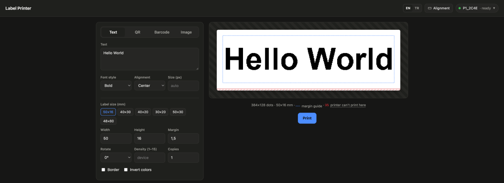

# ble-thermal-printer

Desktop client for the **MPIA P1** Bluetooth thermal label printer (and other printers that use the **Eleph-label** app). Print text, QR codes, barcodes and images from macOS, Linux or Windows. It has a web interface and a command-line tool. No phone or vendor app is needed.



## Features

- **Web interface** with a live preview: text, QR, barcode and image labels; label-size presets, rotation, border, inverted colors, density and copies.
- **Connection management:** scan, pick a printer, connect or disconnect, and auto-reconnect when the printer is turned back on. Shows live status (cover open, out of paper, …) and an event log. It remembers the last printer.
- **Command-line tool** for scripting and one-off prints.
- **Alignment calibration:** for each label size, a test label with mm rulers measures where the printer actually prints, and content is laid out in the printable area.
- English UI and CLI by default, Turkish available.

## Requirements

- Python 3.10+
- Bluetooth LE (on macOS, allow Bluetooth access for your terminal when prompted)

## Installation

```bash
git clone https://github.com/mhmt/ble-thermal-printer.git
cd ble-thermal-printer
python3 -m venv .venv
.venv/bin/pip install -e .
```

> The printer accepts only one Bluetooth connection at a time. If the Eleph-label phone app is connected, close it first.

## Web interface

```bash
.venv/bin/ble-thermal-printer serve  # opens http://127.0.0.1:8765
```

- Design the label on the left; the preview on the right updates as you type. Press **Print** or `⌘P` / `Ctrl+P`.
- The status chip in the top right opens the **connection panel**: scan, connect, disconnect, toggle auto-reconnect, device details and the event log.
- **Alignment** opens the calibration dialog (see below).
- **EN / TR** switches the interface language (remembered in the browser).

The last printer is stored in `~/.config/ble-thermal-printer/config.json` and connected automatically on startup (disable with `--no-autoconnect`).

### Security

The web interface has **no login yet** and listens on `127.0.0.1` by default. These protections are always on:

- **Host allow-list:** requests are served only when the `Host` header is `localhost`, `127.0.0.1`, `::1` or the address passed to `--host`. With `--host 0.0.0.0`, the machine's host name, `<hostname>.local` and its IP addresses are also accepted. Add other names with `--allowed-host printer.example` (repeatable) or the `allowed_hosts` config key. `--allowed-host '*'` turns the check off. This check blocks DNS-rebinding attacks.
- **No cross-site requests:** POST requests must send `Content-Type: application/json`. When a browser sends `Origin` or `Sec-Fetch-Site`, they must match this page. Another website open in your browser therefore cannot print or change settings.
- **Input limits:** request bodies are limited to 8 MB and images to 30 megapixels (PNG, JPEG, GIF, BMP, WebP). Every field is type- and range-checked (label size 10–60 × 5–200 mm, at most 99 copies, at most 1000 characters of text, …). The web interface downsizes large photos before uploading them.
- Responses send a strict Content-Security-Policy and anti-framing headers. Idle connections time out after 30 s.

If you start the server with `--host 0.0.0.0`, anyone who can reach the port can print. Only do this on a network you trust.

## Command line

```bash
ble-thermal-printer scan                                  # list nearby compatible printers
ble-thermal-printer info                                  # device info and status
ble-thermal-printer text "Hello\nWorld" --border
ble-thermal-printer qr "https://example.com" --caption "Example"
ble-thermal-printer barcode 8690000000011 --kind ean13
ble-thermal-printer image logo.png --no-dither
ble-thermal-printer text "Vertical" --rotate 90
ble-thermal-printer text "Test" --preview out.png         # save a PNG instead of printing
ble-thermal-printer calibrate --size 40x30                # print an alignment test label
```

Common options: `--size WxH` (mm, default `40x30` or `label_size` from the config), `--margin`, `--density 1-15`, `--copies`, `--rotate`, `--border`, `--invert`, `--printer NAME_OR_ADDRESS`, `--trim-top/--trim-bottom MM`.

Output is in English. Use `--lang tr` (anywhere in the command) or `BLE_THERMAL_PRINTER_LANG=tr` for Turkish.

## Alignment calibration

Gap-label printers don't always place the image exactly on the label. For example, on one 50×16 mm roll the last ~0.5 mm of a 16 mm image fell into the gap between labels, so content looked shifted down. ble-thermal-printer handles this with an **unprintable band** at the top and bottom for each label size. Content, margins and borders are laid out in the area that remains, and the preview shows the band hatched in red.

To calibrate a new roll:

1. Open **Alignment** in the web interface (or run `ble-thermal-printer calibrate --size WxH`) and print the test label. It has mm rulers on both sides and lines at the very top and bottom.
2. Enter how many mm are missing at the top and bottom, then save.
3. Print a symmetric label (e.g. a QR code with margin 0) and check that the gaps above and below are equal. Adjust in 0.1–0.2 mm steps if needed.

There is no correction by default. The feed position can vary by about ±0.5 mm between prints. Values are stored per label size in the config file (see below).

## Configuration

Settings live in `~/.config/ble-thermal-printer/config.json` (or `$XDG_CONFIG_HOME/ble-thermal-printer/config.json`). The app creates and updates the file; all keys are optional:

```json
{
  "label_size": "50x16",
  "auto_reconnect": true,
  "last_address": "…",
  "last_name": "…",
  "trims": { "50x16": { "top_mm": 0.0, "bottom_mm": 0.5 } }
}
```

| Key | Meaning |
|---|---|
| `label_size` | Default label size (`WxH` in mm) for the CLI and for the web interface on first use. Defaults to `40x30`. |
| `auto_reconnect` | Reconnect automatically when the connection drops (toggle in the connection panel). |
| `last_address`, `last_name` | Printer to connect to on startup; set after a successful connection. |
| `trims` | Alignment calibration per label size, set in the **Alignment** dialog. |
| `allowed_hosts` | Extra host names accepted by the web server (same as `--allowed-host`). |

Set `BLE_THERMAL_PRINTER_CONFIG=/path/to/config.json` to use a different file, for example for a system service.

## Protocol

Verified on an MPIA P1 (BLE name `P1_xxxx`, firmware 6023, 203 DPI, 384-dot / 48 mm print head).

| | |
|---|---|
| BLE | service `0x18F0`, write `0x2AF1`, notify `0x2AF0` (MTU 240, writes sent in 237-byte chunks) |
| Device info | `1B 23 23 4A 58 49 47` (`ESC ##JXIG`) → 116 bytes: `[6:8]` firmware, `[8:10]` width in dots, `[10]` DPI type (0 = 8 dots/mm), `[11]` command mode (1 = ESC, 2 = TSPL), `[14]` speed, `[15]` density, `[17]` paper type, `[22]` compression |
| Status | `1D 61 00` → 4 bytes: `b0 & 0x20` cover open, `b2 & 0x0C == 0x0C` out of paper, `b1 & 0x40` overheated, `b1 & 0x08` cutter error |
| Print job (TSPL) | `SIZE 50 mm,16 mm` · `DENSITY n` · `CLS` · `DIRECTION 0` · `BITMAP 0,0,<bytes per row>,<rows>,0,<data, 0 = black>` · `PRINT 1,<copies>`; each command ends with `\n` |

Labels wider than the head (e.g. 50 mm) are rendered at 384 dots.

The protocol details come from the Eleph implementation in [TiMini-Print](https://github.com/Dejniel/TiMini-Print) and were verified against the hardware.

## Project layout

| Path | Purpose |
|---|---|
| `ble_thermal_printer/protocol.py` | Queries, status parsing, TSPL job builder |
| `ble_thermal_printer/ble.py` | BLE transport (bleak), chunked writes |
| `ble_thermal_printer/render.py` | Text / QR / barcode / image → 1-bit label bitmap |
| `ble_thermal_printer/manager.py` | Persistent connection, state machine, auto-reconnect |
| `ble_thermal_printer/server.py`, `ble_thermal_printer/web.html` | Web interface |
| `ble_thermal_printer/httpguard.py` | Host allow-list, cross-site and body-size checks for the web server |
| `ble_thermal_printer/schema.py` | Validation of label requests received over HTTP |
| `ble_thermal_printer/cli.py`, `ble_thermal_printer/i18n.py` | Command line and its messages |
| `ble_thermal_printer/config.py` | Saved settings (last printer, calibration) |
| `tools/probe.py` | Raw BLE discovery and protocol probe |
| `tests/` | Server tests without a printer: `python -m unittest discover -s tests` |

## License

[MIT](LICENSE)

## Disclaimer

This is an unofficial project, not affiliated with MPIA or the Eleph-label app.
